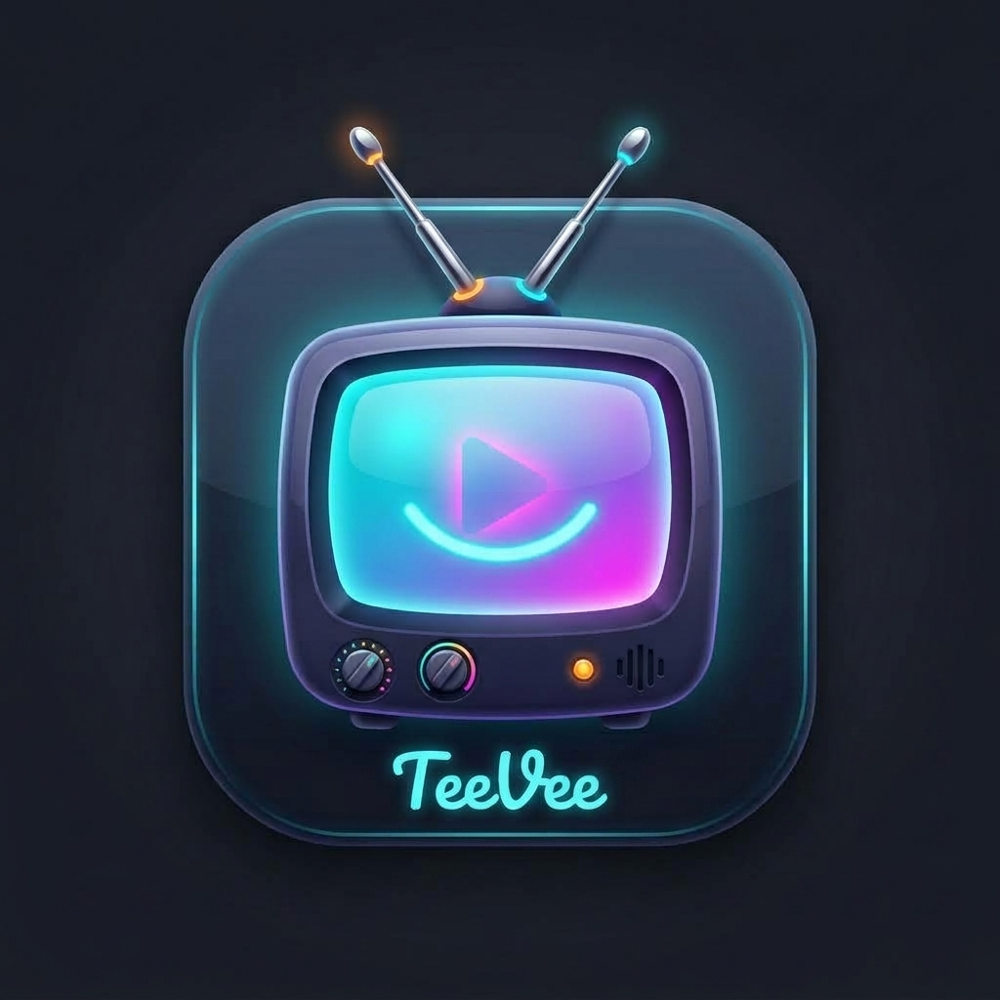
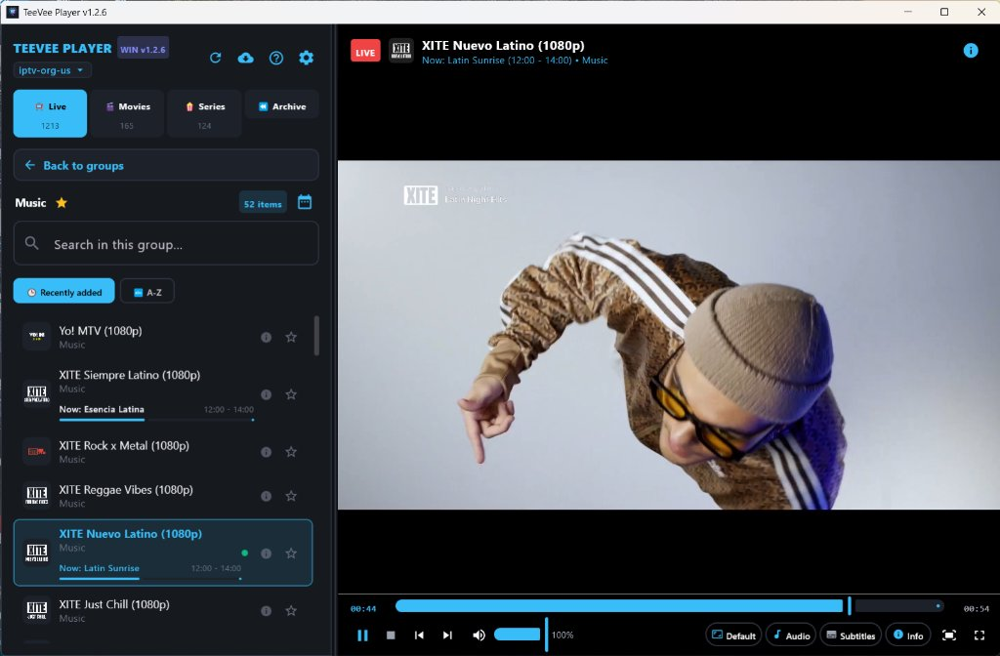
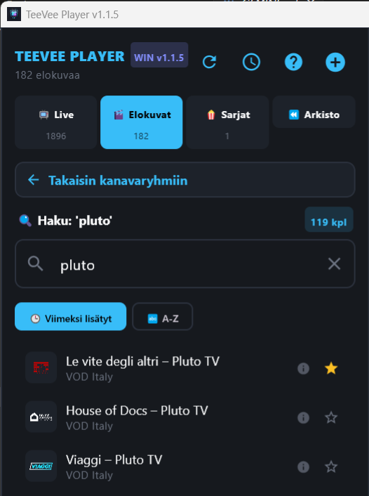
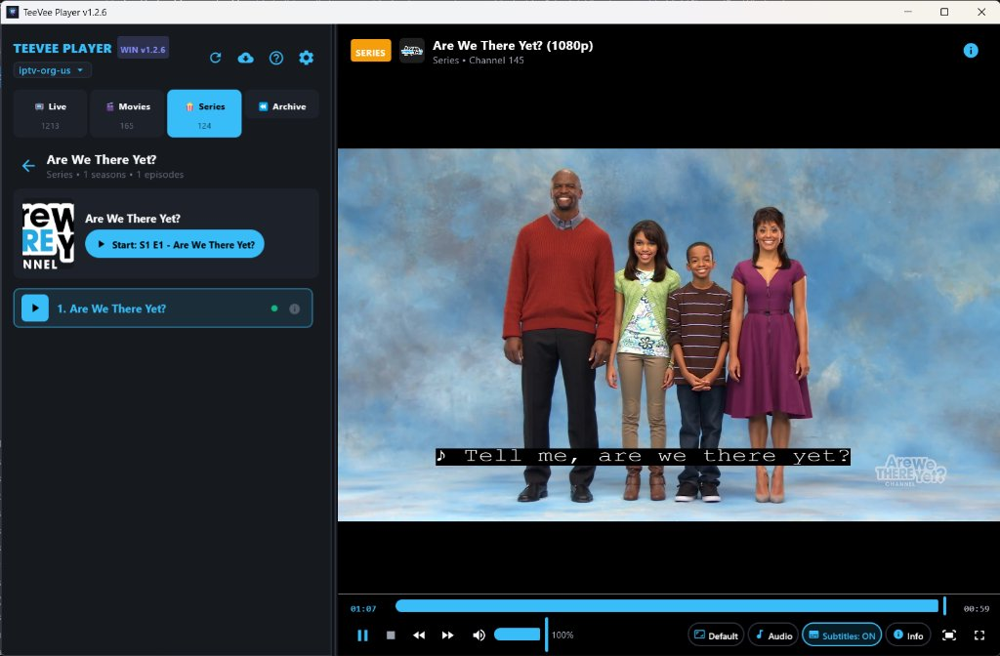

<div align="center">



# TeeVee Player

### The fast, sleek, standalone desktop IPTV player for Windows 10 & 11

[](https://github.com/borgjanne-cmd/TeeVee-Player/releases/latest)
[](https://github.com/borgjanne-cmd/TeeVee-Player/releases/latest)
[](https://kotlinlang.org/)
[](https://www.jetbrains.com/lp/compose-multiplatform/)
[](https://www.virustotal.com/)

<br/>

[📥 **Download Latest Windows Installer (.msi)**](https://github.com/borgjanne-cmd/TeeVee-Player/releases/latest) &nbsp;&bull;&nbsp;
[🌐 **Official Website**](https://teevee-player.netlify.app) &nbsp;&bull;&nbsp;
[📝 **Changelog**](CHANGELOG.md) &nbsp;&bull;&nbsp;
[🇫🇮 **Suomeksi**](KAYTTOOHJE.md)

</div>

---

## 📸 Screenshots

### 📺 Live TV & Main Player View
Featuring dark glassmorphism styling, instant channel surfing, and real-time playback controls:



<br/>

### 🎬 Movies (VOD) & 🍿 TV Series Guide
Blazing-fast category browsing and episode selectors with automatic watch-history tracking:

| 🎬 Movies (VOD) Search | 🍿 TV Series & Episodes |
|:---:|:---:|
|  |  |

---

## ✨ Key Features

- **⚡ Native Desktop Performance:**
  - Built with **Kotlin Multiplatform + Jetpack Compose for Desktop**.
  - Powered by **LibVLC 3.0.24 (FFmpeg 8)** with native GPU hardware acceleration.
  - Starts up instantly with high-performance SQLite caching (WAL mode) capable of handling playlists with over 50,000 channels.

- **📺 Complete IPTV & Media Protocol Support:**
  - Seamlessly streams **HLS (.m3u8), MPEG-TS, RTMP, RTSP**, and direct video files (**MP4, MKV, AVI**).
  - Handles variable bitrates, live DVR buffers, and network reconnects automatically.

- **⏪ 7-Day Catchup TV (Arkisto / Timeshift):**
  - Watch previously aired programs on supported channels with full time-shift and seek controls (supports Xtream Codes & Flussonic protocols).

- **📑 Smart Multi-Playlist Management:**
  - Add unlimited playlists via **M3U / M3U8 URLs, local playlist files, or Xtream Codes API**.
  - Instant one-click switching between playlists directly from the top bar.
  - Automatic background synchronization keeping channel lists and EPG up to date.

- **📅 Electronic Program Guide (EPG):**
  - Integrated XMLTV guide showing currently playing and upcoming shows.
  - High-speed fuzzy search across all channels, categories, and program titles.

- **💬 Multi-Track Audio & OpenSubtitles Integration:**
  - Switch between multi-language audio streams and embedded subtitle tracks.
  - Integrated **OpenSubtitles.com** search & download with real-time sync adjustment (`±0.25s`, `±0.5s`).

- **🖥️ Desktop-Centric Polish:**
  - One-click Fullscreen (`F11` / `F`) and Compact mini-player mode (`F10`).
  - Automatic Windows **sleep & screensaver prevention** during video playback (`SetThreadExecutionState`).
  - Aspect ratio cycling (`16:9`, `4:3`, `16:10`, `Fill`, `Default`).
  - Comprehensive keyboard shortcuts for living-room or desktop control.

- **🔒 100% Private & Standalone:**
  - **No external dependencies:** Fully standalone package with embedded custom JRE runtime and bundled LibVLC. No separate Java or VLC installations needed!
  - **Your data stays local:** No user tracking, no telemetry, no cloud accounts required. Your playlist credentials and history remain strictly on your machine.

---

## 🛡️ Security & Safe Downloads (VirusTotal Verified)

Because TeeVee Player is an independent open-source project without a costly corporate code-signing certificate, Windows SmartScreen may display an informational alert (*"Windows protected your PC"*) upon first launch.

To ensure complete peace of mind, **every official release package is pre-scanned on VirusTotal**:
- ✅ **100% Clean:** 0/70+ security vendors detect any threat.
- 🛡️ **Verification:** Each GitHub Release note contains a direct link to its clean VirusTotal analysis report.
- 🔓 **To install on Windows:** Click *More info* ➔ *Run anyway*.

---

## ⌨️ Keyboard Shortcuts

| Shortcut | Action |
|:---:|---|
| <kbd>Space</kbd> / <kbd>K</kbd> | Play / Pause |
| <kbd>Left</kbd> / <kbd>J</kbd> | Seek backward 10 seconds |
| <kbd>Right</kbd> / <kbd>L</kbd> | Seek forward 10 seconds |
| <kbd>Up</kbd> | Increase volume (+5%) |
| <kbd>Down</kbd> | Decrease volume (-5%) |
| <kbd>M</kbd> | Toggle Mute |
| <kbd>A</kbd> | Cycle audio tracks |
| <kbd>S</kbd> | Cycle subtitle tracks |
| <kbd>C</kbd> | Cycle aspect ratio (16:9, 4:3, Fill...) |
| <kbd>F11</kbd> / <kbd>F</kbd> | Toggle Fullscreen |
| <kbd>F10</kbd> | Toggle Compact Mini-Player |
| <kbd>Esc</kbd> | Exit fullscreen or dismiss modal dialogs |

---

## 🚀 Getting Started

### 1. Download & Install
1. Head over to the [**Latest GitHub Release**](https://github.com/borgjanne-cmd/TeeVee-Player/releases/latest).
2. Download `TeeVee-Player-<version>.msi`.
3. Double-click to run the installer and launch **TeeVee Player** from your Start menu or desktop shortcut.

### 2. Add Your Playlist
1. On first launch, click **+ Add Playlist** (or try out the preloaded demo channels).
2. Choose your input method:
   - **M3U / M3U8 URL:** Enter your streaming provider's link.
   - **Local File:** Select a `.m3u` or `.m3u8` playlist file from your hard drive.
   - **Xtream Codes:** Enter Server URL, Username, and Password for full Live, VOD, Series & Catchup support.
3. Enjoy your channels with instant search and category browsing!

---

## 🌐 Supported Languages

TeeVee Player automatically detects your Windows system language and allows changing it anytime from the top bar:
- 🇬🇧 **English**
- 🇫🇮 **Suomi**
- 🇸🇪 **Svenska**

---

## 💻 System Requirements

- **Operating System:** Windows 10 (64-bit) or Windows 11 (64-bit)
- **Processor:** Any modern dual-core x64 CPU (Intel / AMD)
- **Memory:** 4 GB RAM (8 GB recommended for heavy 4K streams)
- **Storage:** ~300 MB free disk space
- **Display:** 1280×720 minimum resolution (Full HD or 4K recommended)
- **Network:** Broadband Internet connection for smooth live and VOD streaming

---

## 🏗️ Project Architecture & Directory Structure (Agent & Developer Guide)

This section provides a comprehensive structural reference of the project for AI agents and developers working on the codebase.

```
IPTV_windows/
├── .agents/                               # Antigravity agent configuration, custom skills & workflows
│   ├── rules/                             # Agent behavioral rules (e.g., packaging restrictions)
│   └── skills/                            # Autonomous skills (deploy-site, publish-release)
├── docs/                                  # Project documentation assets & screenshots
│   └── screenshots/                       # UI screenshots used in README and website
├── package-resources/                     # Bundled native Windows binaries & dependencies
│   └── common/
│       ├── vlc/                           # Embedded LibVLC 3.0.24 x64 binaries, core DLLs & plugins
│       ├── vcruntime140*.dll              # Microsoft Visual C++ 2015-2022 x64 Redistributable runtime DLLs
│       └── msvcp140*.dll                  # Visual C++ standard library DLLs
├── scripts/                               # Deployment, release & sync automation scripts
│   ├── deploy_site.ps1                    # Packages and deploys website to Netlify
│   ├── publish_release.ps1                # Builds releases and creates GitHub releases via API
│   └── sync_docs_and_readme.ps1           # Synchronizes documentation and README to GitHub repository
├── site/                                  # Official landing website source files (HTML/CSS/JS)
│   ├── assets/                            # Web graphics, logos, and preview screenshots
│   ├── index.html                         # Production landing page with responsive glassmorphism design
│   ├── styles.css                         # Pure CSS stylesheet with modern responsive styling
│   └── app.js                             # Client-side dynamic release fetching and language switching
├── src/
│   ├── main/
│   │   ├── kotlin/com/gemini/iptv/
│   │   │   ├── Main.kt                    # Compose Desktop application entry point & lifecycle management
│   │   │   ├── AppConfig.kt               # Global configuration, constants, AppData paths & LibVLC setup
│   │   │   │
│   │   │   ├── data/                      # Data layer (Database, Repositories, Parsers, Models)
│   │   │   │   ├── db/
│   │   │   │   │   └── DatabaseManager.kt # SQLite JDBC interface, WAL mode, migrations, indexing & schema
│   │   │   │   ├── metadata/
│   │   │   │   │   └── VideoMetadataService.kt # Video/stream metadata extraction & caching
│   │   │   │   ├── model/
│   │   │   │   │   ├── Channel.kt         # Core IPTV channel entity (URL, logos, TVG mappings, flags)
│   │   │   │   │   ├── EpgProgram.kt      # EPG guide program model (start/stop timestamps, title, synopsis)
│   │   │   │   │   ├── SeriesModel.kt     # TV Series, Season, Episode data models & playback progress
│   │   │   │   │   └── StreamType.kt      # Stream classifications (LIVE, MOVIE, SERIES, ARCHIVE)
│   │   │   │   ├── parser/
│   │   │   │   │   ├── M3UStreamingParser.kt   # High-throughput streaming M3U/M3U8 parser for massive playlists
│   │   │   │   │   ├── SeriesParser.kt         # Regex & heuristics parser grouping VOD items into series/seasons
│   │   │   │   │   └── XmltvStreamingParser.kt # Memory-efficient streaming XMLTV parser (handles gigabyte files)
│   │   │   │   ├── repository/
│   │   │   │   │   ├── ChannelRepository.kt    # Channel filtering, favorites, visibility, and search operations
│   │   │   │   │   ├── EpgRepository.kt        # EPG program caching, matching algorithms & automatic cleanup
│   │   │   │   │   ├── PlaylistRepository.kt   # Playlist CRUD, atomic background refresh & fallback handling
│   │   │   │   │   └── SeriesEpisodeLoader.kt  # Async loader and organizer for series episodes & seasons
│   │   │   │   ├── subtitles/
│   │   │   │   │   ├── OpenSubtitlesModels.kt  # Data models for OpenSubtitles REST API responses
│   │   │   │   │   └── OpenSubtitlesService.kt # Search, fetch and download external subtitle tracks (.srt)
│   │   │   │   ├── update/
│   │   │   │   │   └── AppUpdateManager.kt     # Checks GitHub Releases API for new app versions
│   │   │   │   └── util/
│   │   │   │       └── CatchupUrlBuilder.kt    # Generates dynamic timeshift URLs (Xtream & Flussonic protocols)
│   │   │   │
│   │   │   ├── i18n/                      # Internationalization (English, Finnish, Swedish)
│   │   │   │   ├── AppLanguage.kt         # Supported language enum and system locale detection
│   │   │   │   ├── AppStrings.kt          # Interface defining all localized UI strings
│   │   │   │   ├── EnStrings.kt           # English string definitions
│   │   │   │   ├── FiStrings.kt           # Finnish string definitions
│   │   │   │   ├── SvStrings.kt           # Swedish string definitions
│   │   │   │   └── LanguageContext.kt     # Compose CompositionLocal provider for reactive language switching
│   │   │   │
│   │   │   ├── player/                    # Video playback subsystem
│   │   │   │   └── VlcPlayerController.kt # VLCJ / LibVLC wrapper, GPU acceleration, track selection, sleep lock
│   │   │   │
│   │   │   ├── ui/                        # Presentation layer (Jetpack Compose for Desktop)
│   │   │   │   ├── MainScreen.kt          # Primary layout, sidebar, channel lists, splitter & playback viewport
│   │   │   │   ├── components/            # Reusable UI widgets & modal dialogs
│   │   │   │   │   ├── AddPlaylistDialog.kt        # Dialog for adding M3U, URL, local file, or Xtream Codes
│   │   │   │   │   ├── AppSplashScreen.kt          # Startup loading splash screen with progress indicators
│   │   │   │   │   ├── ArchiveScheduleView.kt      # 7-day TV archive / catchup schedule browser
│   │   │   │   │   ├── AspectRatioDialog.kt        # Aspect ratio selector (16:9, 4:3, Fill, etc.)
│   │   │   │   │   ├── AsyncImage.kt               # Async image loader with local disk caching for logos/posters
│   │   │   │   │   ├── AudioTrackDialog.kt         # Multi-language audio stream selector
│   │   │   │   │   ├── CategoryListItem.kt         # Sidebar category item with badge counters
│   │   │   │   │   ├── ChannelCustomizationTab.kt  # Channel renaming, hidden toggles, and custom ordering
│   │   │   │   │   ├── ChannelListItem.kt          # Channel card with current/upcoming EPG progress bar
│   │   │   │   │   ├── EpgSyncDialog.kt            # EPG synchronization status and trigger dialog
│   │   │   │   │   ├── HelpDialog.kt               # Keyboard shortcuts & user help modal
│   │   │   │   │   ├── ImagePreviewTooltip.kt      # Channel and series poster hover preview
│   │   │   │   │   ├── PinEntryDialog.kt           # Parental control / category lock PIN authentication
│   │   │   │   │   ├── PlayerControls.kt           # Video control overlay (seek bar, volume, fullscreen, tracks)
│   │   │   │   │   ├── PlaylistManagerDialog.kt    # Active playlist switcher, updater, and manager
│   │   │   │   │   ├── SeriesDetailView.kt         # Series episode selector, synopsis, and season tabs
│   │   │   │   │   ├── SeriesListItem.kt           # Series grid item with episode badge and poster
│   │   │   │   │   ├── SubtitleDialog.kt           # Subtitle selector and OpenSubtitles search dialog
│   │   │   │   │   ├── UpdateDialog.kt             # In-app new version alert and installer download modal
│   │   │   │   │   └── VideoInfoDialog.kt          # Video resolution, codec, bitrate, and FPS inspector
│   │   │   │   ├── icons/                 # Material 3 custom application vector icons
│   │   │   │   │   ├── AppIconsAutoMirrored.kt
│   │   │   │   │   ├── AppIconsFilled.kt
│   │   │   │   │   └── AppIconsOutlined.kt
│   │   │   │   └── theme/
│   │   │   │       └── Theme.kt           # Dark glassmorphism color palette, shapes, and typography
│   │   │   │
│   │   │   └── util/                      # Windows platform utilities
│   │   │       ├── AppLogger.kt               # Rolling file & console logging system
│   │   │       ├── WindowsFullscreenHelper.kt # Win32 borderless fullscreen window management
│   │   │       └── WindowsPowerManager.kt     # Kernel32 SetThreadExecutionState wrapper (screensaver prevention)
│   │   └── resources/                     # Embedded resources, application icons, and demo data
│   └── test/                              # Automated unit tests covering core logic
│       └── kotlin/com/gemini/iptv/        # 30+ comprehensive unit test suites
│           ├── WindowsFullscreenHelperTest.kt
│           ├── data/
│           │   ├── metadata/VideoMetadataServiceTest.kt
│           │   ├── parser/M3UStreamingParserTest.kt, SeriesParserTest.kt
│           │   ├── repository/            # Tests for DB persistence, EPG matching, isolation & update atomicity
│           │   ├── subtitles/OpenSubtitlesSerializationTest.kt
│           │   ├── update/AppUpdateManagerTest.kt
│           │   └── util/CatchupUrlBuilderTest.kt
│           ├── i18n/AppStringsTest.kt
│           ├── player/                    # Playback reconnection, error recovery, and VOD tests
│           ├── site/SiteAssetIntegrityTest.kt
│           └── util/                      # Logger and Windows API power management tests
├── build.gradle.kts                       # Gradle build configuration, dependencies & native packaging tasks
├── settings.gradle.kts                    # Gradle project settings
├── AGENTS.md                              # Mandatory rules and instructions for AI agents working in this repo
├── GEMINI.md                              # Project conventions and rules
├── CHANGELOG.md                           # Multilingual user-facing changelog (FI, SV, EN)
└── README.md                              # Project front page & technical documentation
```

### ⚙️ Core Technical Stack

| Component | Technology | Description |
|---|---|---|
| **Language & Runtime** | Kotlin 2.0.21 / JVM | Jetpack Compose Multiplatform for Desktop (v1.7.0) |
| **Media Engine** | LibVLC 3.0.24 (x64) via VLCJ 4.8.3 | Hardware-accelerated Direct3D decoding, HLS, MPEG-TS, VOD |
| **Database** | SQLite via `sqlite-jdbc 3.46.1.3` | High-concurrency local storage using `WAL` (Write-Ahead Logging) mode |
| **Networking** | OkHttp 4.12.0 | High-performance streaming HTTP client for playlists and EPG downloads |
| **Async Operations** | Kotlin Coroutines & Flow 1.8.1 | Seamless asynchronous data processing and UI state dispatching |
| **Serialization** | `kotlinx-serialization-json 1.7.3` | Fast JSON parsing for APIs and settings persistence |
| **Native Packaging** | Compose Desktop Packager | Generates self-contained Windows MSI installers with bundled JRE & LibVLC |

### 📋 Key Rules for AI Agents

When modifying this repository, AI agents must strictly follow the instructions defined in [`AGENTS.md`](AGENTS.md):
1. **Never build installers autonomously:** Tasks like `packageMsi`, `createDistributable`, or `createUpdateZip` are heavy and must only be executed upon explicit user request.
2. **Code integrity:** Never replace existing code with placeholders like `// ... rest of the code`. Always produce complete, working implementations.
3. **Desktop & Mouse-First UI:** Do not implement TV D-Pad focus traps or remote constraints. Standard mouse interactions, splitters, context menus, and keyboard shortcuts take priority.
4. **Impact analysis on core components:** Always assess ripple effects before modifying shared classes such as `MainScreen.kt`, `DatabaseManager.kt`, or `VlcPlayerController.kt`.
5. **Quality verification:** Validate logic changes using fast automated tests (`.\gradlew.bat test`) and compilation (`.\gradlew.bat compileKotlin`).

---

## 💬 Contact & Support

Have questions, feedback, or feature suggestions?
- 🌐 **Official Website:** [teevee-player.netlify.app](https://teevee-player.netlify.app)
- ✉️ **Email Support:** [teevee.jannejb@gmail.com](mailto:teevee.jannejb@gmail.com)

<br/>

<div align="center">

*Built with [JetBrains Compose Multiplatform](https://www.jetbrains.com/lp/compose-multiplatform/) & [LibVLC / VideoLAN](https://www.videolan.org/).*

</div>
